<a href="https://github.com/justAnArthur/just-ai-desktop/releases/latest"></a>

# JustAIDesktop

A macOS app for running Claude Code across several Claude accounts. Each profile is a Claude Code config folder (`~/.claude` is `default`, `~/.claude-work` is `work`); JustAIDesktop lists every profile with its plan and its 5-hour and weekly limits, shows the sessions on disk grouped by profile, and lets you start, read and steer them in one window, with each session's tasks, changed files and git state beside the transcript.

Built on [just-apps](https://github.com/justAnArthur/just-apps) (Tauri + React) and the [`@justanarthur/modo-ui`](https://github.com/justAnArthur/modo/tree/main/ui) design system. It drives the `claude` CLI you already have installed.

**[Download for Mac →](https://github.com/justAnArthur/just-ai-desktop/releases/latest/download/JustAIDesktop.zip)**

## Install

1. Download [`JustAIDesktop.zip`](https://github.com/justAnArthur/just-ai-desktop/releases/latest/download/JustAIDesktop.zip) (or a versioned `JustAIDesktop-x.y.z.zip` from [Releases](../../releases)), unzip it and move `JustAIDesktop.app` to Applications. macOS 13+, Apple silicon or Intel.
2. The app isn't notarized, so open it the first time with right-click → **Open**, or:

```bash
xattr -dr com.apple.quarantine /Applications/JustAIDesktop.app
```

3. Install [Claude Code](https://docs.anthropic.com/en/docs/claude-code) if you haven't (`claude` on your `PATH`); the app tells you when it can't find it.

After that it updates itself: a little after launch and every six hours, and on demand from **Check for updates** at the bottom of the Profiles view (⌘,), it reads `latest.json` from the newest release. A new version waits in a toast until you choose **Restart to update**; the bundle's signature is verified before it installs. No second right-click → Open.

## Develop

JustAIDesktop is `apps/ai-desktop` in the just-apps monorepo and builds only inside a just-apps checkout. From the just-apps root:

```bash
bun install
bun run app dev ai-desktop          # the desktop app
```

```bash
cd apps/ai-desktop && bun run dev   # the UI in a browser, against mock commands
```

```bash
bun test && bun run check           # in apps/ai-desktop
```

`app.json` is the app's config; `bun run app sync ai-desktop` writes `src-tauri/tauri.conf.json` and the capabilities from it. Layout and rules: [`AGENTS.md`](AGENTS.md).

```text
src/workspace/   the window: profiles, sessions, transcript, side pane, sign-in
src/*.ts         profiles, sessions, panes, attachments, notifications (tested)
src/native/      the native commands and their browser mocks
src-tauri/       the app's own Rust commands (git)
assets/brand/    logo, icon, wordmark and lockups
```

## Releases

Conventional Commits scoped to `just-ai-desktop`, `ai-desktop`, `app`, `ui` or `native` bump the version and tag `just-ai-desktop@x.y.z` via [just-github-actions-n-workflows](https://github.com/justAnArthur/just-github-actions-n-workflows). The tag builds the universal macOS app, signs the updater bundle and attaches the zip, the bundle and `latest.json` to its GitHub release.

## Brand

The mark is a terminal head whose eyes are the prompt `›` and the cursor `|`. Masters are in [`assets/brand`](assets/brand): `icon.svg` (app icon), `icon-dark.svg`, `logo*.svg`, `wordmark-*.svg`, `lockup-*.svg`. The app icon is generated from `icon-1024.png` with `bun run app icons ai-desktop <png>`.

JustAIDesktop is an independent project, not made by or affiliated with Anthropic.

## License

[FSL-1.1-MIT](LICENSE.md): source available, free to use, modify and run for anything except a competing product. Each version becomes MIT two years after its release.
